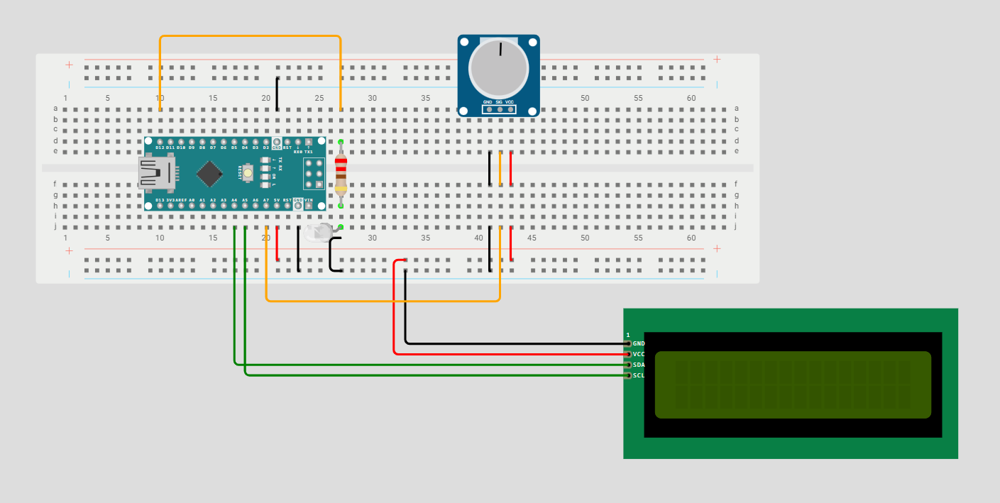

# Sound Controlled LED
An Arduino-based sound-controlled LED system using a microphone sound sensor to detect changes in sound. When a change in sound is over a threshold, the LED will be toggled ON/OFF. 

---

## 🚀 How It Works

When powered on, the sound sensor immediately starts picking up sound levels. It waits for a change in sound that goes over the set threshold, and if one is detected, the LED will be toggled ON/OFF, depending on its current state. The I2C LCD will display the LED's status (ON/OFF) and the range (current change in sound).

### Hardware
- **Development Board:** Arduino Nano
- **Main Components:** I2C LCD + Sound Sensor (KY-038)
- **Software:** Arduino IDE

### Cool Features
- **Sound-Controlled** LED - no switch or button
- Display for current LED status and range
- Portability

---

## 📊 Circuit Layouts

### Wiring Diagram

Below is the wiring diagram for the project:

**Note: This wiring diagram was made in Wokwi. At the time, Wokwi doesn't have the Power MB V2 or sound sensor in the actual build, so the wiring diagram is an approximation of the physical build but retains the correct wiring and functionality. The sound sensor is represented by a potentiometer in the wiring diagram, and sound levels are based on the potentiometer's readings.**

### Schematic

Below is the schematic:

*Schematic coming soon*

## 🔗 Wokwi Simulation
Try the interactive simulation of the project here:

[Open in Wokwi](https://wokwi.com/projects/480458427245851649)

---
## 🖼️ Project Photo

See the project (may have some issues viewing it on desktop):

[Click here](Sound_Controlled_LED_Image.png)

## 🎥 Video Demonstration

Watch the project in action + an explanation of the build:

[▶ Watch the Video](YOUTUBE_LINK_NOT_READY_YET_COME_BACK_LATER)

---

## 📁 Repository Contents

- `Sound_Controlled_LED.ino` — Arduino source code
- `README.md` — Project documentation
- `LICENSE` — Apache License 2.0
- `Sound_Controlled_LED_Image.png` — Project photo
- `Sound_Controlled_LED.png` — Wiring Diagram 
- `Schematic.png` — Coming Soon!

---

## 🛠️ Components Used

- Arduino Nano Board
- LED
- Resistors
- Power MB V2 + 9V Battery
- KY-038 Sound Sensor
- I2C LCD
- Jumper wires

---

## 💡 What I Learned

I learned how to use the **KY-038 Sound Sensor Module**. I also learned how to detect sudden changes in sound using the module. This can be a cough, sneeze, or clap. Using this knowledge, I created a Sound-Controlled LED that toggles ON/OFF whenever a sudden change in sound is detected.

---

## 📜 License

This project is licensed under the Apache License 2.0.
